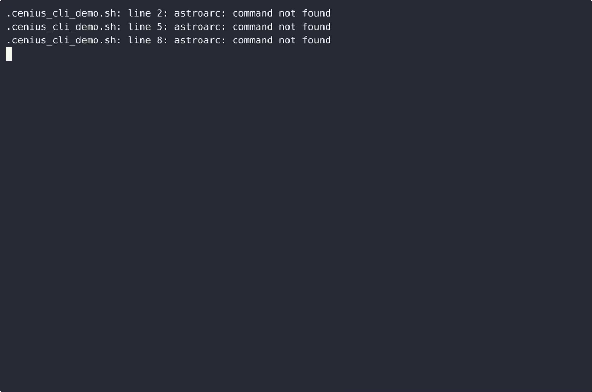
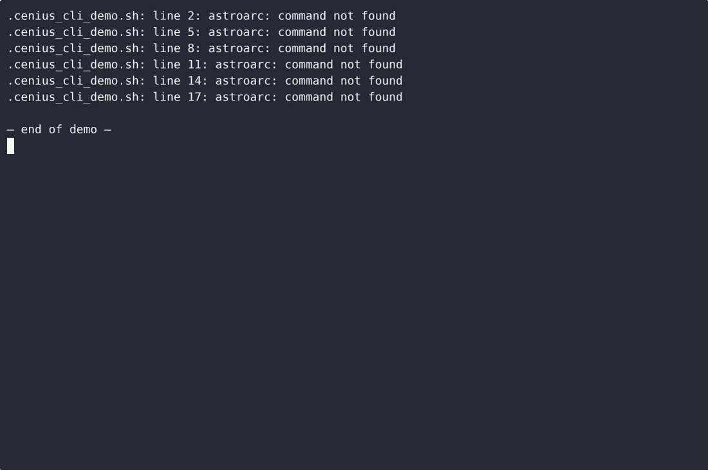

# AstroArc — complete Full-stack app command-line tool example app

If you want a self-hosted command-line tool without the vendor lock-in, **AstroArc** is ready to run. Built with Full-stack app and Apache-2.0-licensed, AstroArc ships complete — one clone, one install command. Build AstroArc as a single-file Python CLI that records meteor shower peak dates and radiant constellations, tracks hourly observation counts per session, and prints an aligned year-over-year shower maxima table. [Open AstroArc on cenius.ai](https://cenius.ai/marketplace/p/astroarc?ref=gh&utm_campaign=astroarc-webapp) to customise it without touching a line of AstroArc code.


[](LICENSE)  [](https://cenius.ai)

[](https://cenius.ai/marketplace/p/astroarc?ref=gh&utm_campaign=astroarc-webapp)

> **▶ [Open & edit in cenius.ai](https://cenius.ai/marketplace/p/astroarc?ref=gh&utm_campaign=astroarc-webapp)** — one click to an editable workspace: describe changes in plain English, get an instant preview, one-click deploy and host. Modifications made on the platform come with full rebrand & relicense rights.

_Local clone? See [Quick start](#quick-start) below. cenius.ai is the zero-setup path._

## Demo


▶ **[See it in action](https://cenius.ai/marketplace/p/astroarc?ref=gh&utm_campaign=astroarc-webapp)** — full demo on the project page · [MP4](.github/media/demo.mp4)

## Screenshots

 

## Features

- Record shower peaks and radiants
- Track hourly observation counts
- Compare shower maxima across years

## Quick start

```bash
./install.sh   # installs dependencies + seeds demo data
```

See [`INSTALL.md`](INSTALL.md) for full setup and usage instructions.

## Architecture

Open the repo and you'll find a complete Full-stack app application (28 files). Top-level layout: `tests/`. The setup script (`install.sh`) installs runtime dependencies and loads a starter dataset so the app is immediately usable. Step-by-step setup guide: [`INSTALL.md`](INSTALL.md).

## Usage guide

Every example below is a real transcript from the built tool. `SESSION` stands for a session
id printed by `session start` (a unique prefix such as `0fc81f74` works too).

```bash
export ASTROARC_DATA=~/astroarc-demo.json    # keep the demo out of your real log
export ASTROARC_PASSPHRASE=cenius            # the passphrase this store will be created with
```

### 1. Record a shower

```console
$ astroarc shower add --name Perseids --constellation Perseus --peak 2024-08-12
saved  Perseids / Perseus / peak 2024-08-12 (2024)
next   astroarc session start --shower Perseids --date 2024-08-12
```

Bad input is refused before anything is stored:

```console
$ astroarc shower add --name Draconids --constellation Draco --peak 2024-13-40
error: peak date '2024-13-40' is not a real calendar date (example: 2024-08-12) - nothing was written
$ echo $?
2
```

Re-adding the same name and peak date reports the existing record instead of duplicating it.
The same name with a *different* peak date is a separate record (one row per name + peak date).

### 2. List what you have

```console
$ astroarc showers
Showers  2 recorded / newest peak first
┌──────────┬───────────────┬────────────┬──────┐
│ Shower   │ Constellation │ Peak date  │ Year │
├──────────┼───────────────┼────────────┼──────┤
│ Geminids │ [redacted]        │ 2024-12-14 │ 2024 │
│ Perseids │ Perseus       │ 2024-08-12 │ 2024 │
└──────────┴───────────────┴────────────┴──────┘
```

With nothing recorded yet, the empty state names the exact command that fills it:

_Full guide: [`USAGE.md`](USAGE.md)_

## FAQ

### Can I deploy AstroArc on my own infrastructure?

Pull the repo, run `./install.sh`, and you are up — the script installs packages and pre-seeds the database. [`INSTALL.md`](INSTALL.md) covers any platform-specific tweaks.

### How do I customise AstroArc's branding?

White-labeling is supported: fork the MIT-licensed source and rebrand it yourself, or use [cenius.ai](https://cenius.ai/marketplace/p/astroarc?ref=gh&utm_campaign=astroarc-webapp) to make changes in a guided workspace — platform modifications come with full rebrand rights.

### Can I use AstroArc in a commercial project?

Yes. The code is Apache-2.0-licensed — use it, modify it, and ship it commercially. See [LICENSE](LICENSE).

### Which framework or language does AstroArc use?

Full-stack app end-to-end. Every file you need to run the app is here in this repository — code, configuration, seed data. Highlights include compare shower maxima across years.

### Can I change AstroArc without writing code?

Yes — [load it on cenius.ai](https://cenius.ai/marketplace/p/astroarc?ref=gh&utm_campaign=astroarc-webapp), describe the change in plain English, and you get back a fresh build with your modification applied.

## License & rebranding

Released under the [Apache License 2.0](LICENSE) (© 2026 Cenius AI) — free for personal and commercial use. The Cenius name/logo are trademarks (see NOTICE).

**Need a customized version?** [Remix this app on cenius.ai](https://cenius.ai/marketplace/p/astroarc?ref=gh&utm_campaign=astroarc-webapp) — modifications made on the platform come with **full rebrand & relicense rights** over your derivative.

## Built with cenius.ai

This entire application — code, design, seeded demo data — was generated on **[cenius.ai](https://cenius.ai)** from a plain-English description.

- 🚀 [Build your own app on cenius.ai](https://cenius.ai)
- 🎛️ [Remix AstroArc on the marketplace](https://cenius.ai/marketplace/p/astroarc?ref=gh&utm_campaign=astroarc-webapp) — open it in a workspace, prompt for changes, and ship your own version.

More open-source apps: [the Cenius-ai catalog](https://github.com/Cenius-ai) · [showcase index](https://github.com/Cenius-ai/showcase)
